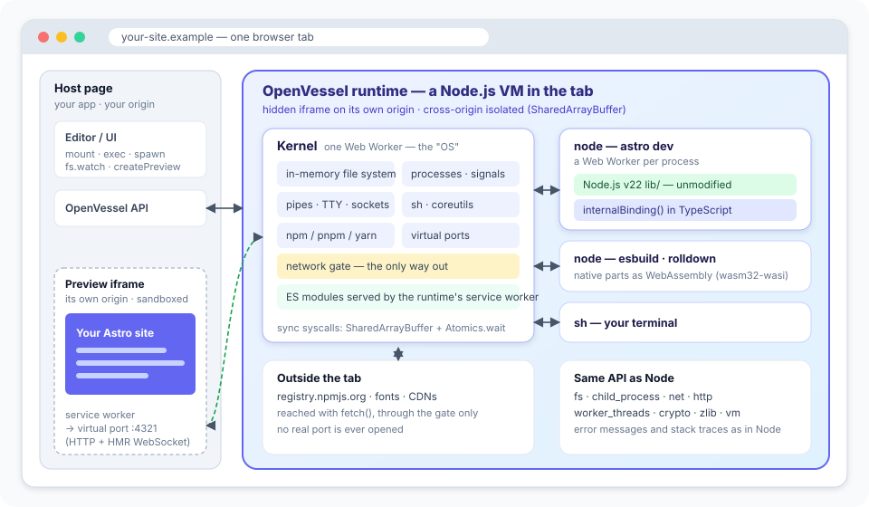
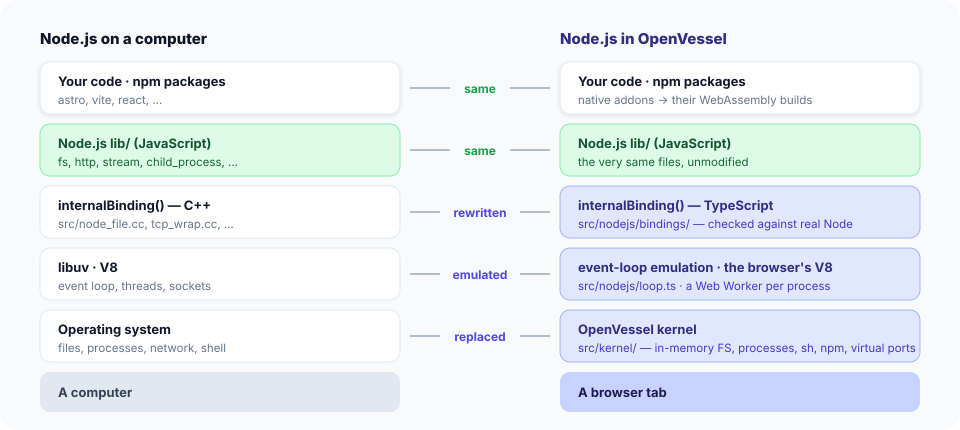

# How OpenVessel works

[日本語](how-it-works.ja.md)

OpenVessel is easiest to think of as **a small virtual machine for Node.js that lives inside a browser
tab**. Like a VM, it has its own operating system (a kernel with a file system, processes and a shell),
its own programs (Node.js, npm, Astro), and controlled ways in and out (a network gate, and virtual
ports for the preview). Unlike a VM, it doesn't emulate a CPU: JavaScript and WebAssembly run directly
on the browser's engine.



## The pieces

### The kernel — the "operating system"

One Web Worker plays the role of the operating system. It owns:

- **an in-memory file system** (directories, files, symlinks, permissions bits, timestamps, watchers),
- **processes** (each with a pid, file descriptors, a working directory, environment, exit codes and signals),
- **pipes, terminals and sockets** (a TTY with a line discipline for the terminal, socket pairs for
  TCP and Unix sockets between processes),
- **a shell and coreutils** (`sh`, `ls`, `cat`, `grep`, `ps`, …) and **package managers** (`npm`,
  `pnpm`, `yarn`, `bun` — the same client handles all four lockfile formats),
- **virtual ports**: when a process listens on port 4321, nothing is opened on your machine; the kernel
  records the listener and connects the preview to it,
- **the network gate**: the only way to reach the internet. The embedding page decides what is allowed
  (presets such as the npm registry, prompts per host, or everything).

### Processes — Node.js itself

Every `node` process is its own Web Worker. It runs **Node.js v22's own JavaScript** (`lib/`) without
changes. Node's `lib/` normally sits on top of C++: about fifty `internalBinding()` modules (files,
streams, TCP, timers, crypto, zlib, modules, workers…), libuv's event loop and the operating system.
OpenVessel re-implements exactly that part, in TypeScript:



- **System calls are synchronous**, as in a real OS. A process writes a request into a
  `SharedArrayBuffer` and sleeps in `Atomics.wait` until the kernel answers. That is how
  `fs.readFileSync`, `child_process.spawnSync` or a synchronous `require()` work in a browser.
- **The event loop** (timers, immediates, `process.nextTick`, handles that keep a process alive,
  `beforeExit`/`exit`) is emulated in `src/nodejs/loop.ts` with the order Node uses.
- **ES modules are real browser modules.** Their sources are handed to the runtime's service worker,
  which serves them to the process, so `import`, `import.meta` and top-level `await` are the browser's.
- **Native addons become WebAssembly.** npm installs the WebAssembly build of packages that have one
  (esbuild, rollup, rolldown, lightningcss, sharp, napi-rs `wasm32-wasi` bindings), and `node:wasi`
  runs them. For packages without one, OpenVessel builds a compat package — usually by compiling the
  project to `wasm32-wasi` itself (Pagefind is built this way).

Because the JavaScript half is Node's own, behaviour comes out the way Node does it: error messages
and codes, argument validation, stack traces with `node:fs:441:20`, stream back-pressure, the order of
events. Each binding is tested against the same call on real Node, and Node's own test suite is run in
OpenVessel ([compatibility](compatibility.md)).

### The preview

A dev server inside OpenVessel listens on a virtual port. To show it, OpenVessel opens an iframe on a
third origin whose service worker forwards every request (and the HMR WebSocket) to the kernel, which
hands it to the server process as bytes on a socket — exactly as if it had come over TCP.

```
preview iframe ──fetch──▶ preview service worker ──▶ kernel: virtual port 4321 ──▶ node (astro dev)
                                                    socket pair, HTTP/1.1 bytes ◀──
```

### The way out

A process that calls `fetch`, `http.get` or `net.connect` to an outside host is talking to the kernel.
The kernel checks the network policy and makes the request with the browser's `fetch`. For raw sockets
it reads the HTTP/1.1 request from the socket and writes the response back as bytes, so libraries that
bring their own HTTP client (undici, axios, got) work unchanged. TLS is done by the browser, which also
verifies the certificate.

## Three origins

| Origin | Holds | Why separate |
|---|---|---|
| Host page | your UI and the OpenVessel API | code in the VM can't touch your page |
| Runtime | the kernel, the processes, the network gate | it is the only one that can reach out, and only through the gate |
| Preview | the site being developed | the site's own JavaScript can't reach the runtime or your page |

The three talk over `postMessage` channels. The runtime and the preview need cross-origin isolation
(`Cross-Origin-Opener-Policy`, `Cross-Origin-Embedder-Policy`) for `SharedArrayBuffer`. On hosts that
can't set headers (GitHub Pages), the service workers add them. See [SECURITY.md](SECURITY.md).

## A walk through `npm install && npm run dev`

1. The host page calls `vessel.exec(...)`. The kernel starts `sh`, which parses the command line.
2. `npm install` runs in the kernel. It resolves the dependency tree like npm (hoisting, peer
   dependencies, lockfiles), fetches tarballs through the network gate, verifies integrity, and
   unpacks them into the in-memory file system. Native packages are swapped for WebAssembly builds or
   compat packages.
3. `npm run dev` starts `node node_modules/.bin/astro dev`: a new Web Worker boots Node.js (bootstrap
   in about 50 ms from a warm pool), loads Astro and Vite as ES modules, and Vite starts esbuild and
   rolldown as WebAssembly.
4. Astro listens on port 4321. The kernel tells the host page (`server-ready`), which creates the
   preview iframe.
5. You edit a file. The host writes it with `vessel.fs.writeFile`; the kernel notifies watchers;
   Vite's file watcher (Node's `fs.watch`) fires, Astro rebuilds the module and sends an HMR message
   over the WebSocket; the preview updates.

## Where things are in the source

| Directory | Contents |
|---|---|
| `src/kernel/` | the kernel: `vfs.ts`, `proc.ts`, `io.ts`, `syscalls.ts`, `net.ts`, `tcp.ts`, `outbound.ts`, `sh/`, `coreutils.ts`, `npm/` |
| `src/nodejs/` | Node.js in a worker: `boot.ts`, `loop.ts`, `options.ts`, `bindings/` (one file per `internalBinding`) |
| `src/runtime/` | the runtime iframe and its service worker |
| `src/preview/` | the preview relay and its service worker |
| `src/host/` | the API for the embedding page |
| `compat/` | compat packages for native-only npm packages |
| `test/node-compat/` | runs Node's own test suite in OpenVessel |
| `corpus/` | real Astro sites used as an end-to-end test |
